<div align="center">

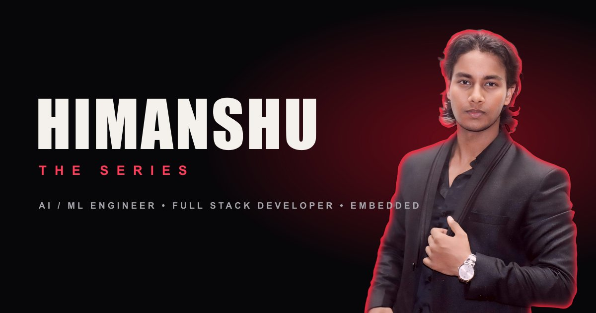

# HIMANSHU — THE SERIES

**A cinematic, streaming-inspired portfolio for Himanshu Kumar**
<br />
AI / ML Engineer · Full-Stack Developer · Embedded Linux · M.Tech CSE @ NIT Silchar

*Every section is an episode. Every project is an Original. The whole site plays like a series.*

<br />


[**📄 Resume**](public/assets/Himanshu_Kumar_Resume.pdf) &nbsp;·&nbsp;
[**💼 LinkedIn**](https://www.linkedin.com/in/himanshukumar111/) &nbsp;·&nbsp;
[**🐙 GitHub**](https://github.com/himanshugithub360) &nbsp;·&nbsp;
[**✉️ Email**](mailto:himanshuramgariya@gmail.com)

</div>

<br />

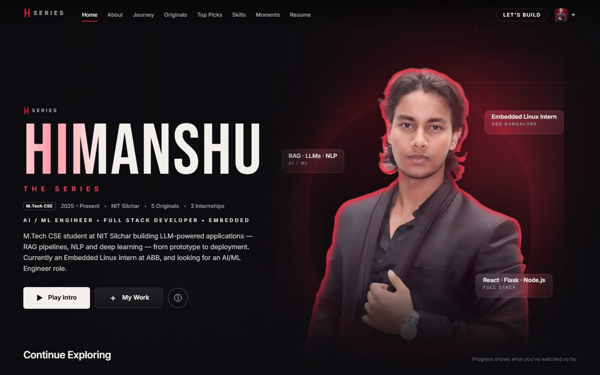

---

## ✨ Highlights

<table>
  <tr>
    <td width="50%" valign="top">
      <h3>🎬 Opens like a show</h3>
      A cinematic title sequence, a “Who’s watching?” screen, and a home page that behaves like a streaming billboard — parallax portrait, light streaks and floating chips.
    </td>
    <td width="50%" valign="top">
      <h3>🎯 Built for recruiters</h3>
      Recruiters pick the role they’re hiring for — <b>AI / ML</b>, <b>Full-Stack</b> or <b>Embedded</b> — and the whole site reorders around it.
    </td>
  </tr>
  <tr>
    <td valign="top">
      <h3>🗺️ A journey in seasons</h3>
      Education, internships and projects told as seasons and episodes. Open any episode for the full role, every bullet, and a jump to the related project.
    </td>
    <td valign="top">
      <h3>🍿 Projects as Originals</h3>
      Each project gets a poster, a full-screen overlay with impact numbers, contribution bullets, tech stack, live demo and GitHub links.
    </td>
  </tr>
  <tr>
    <td valign="top">
      <h3>🛠️ No-code admin dashboard</h3>
      Edit every word, colour, font, project, photo and resume from <code>/admin</code> — then publish to GitHub with one button.
    </td>
    <td valign="top">
      <h3>📱 Fast, accessible, responsive</h3>
      Reduced-motion support, keyboard controls, touch-friendly rails, responsive WebP portraits and code-split overlays.
    </td>
  </tr>
</table>

---

## 🎞️ The experience

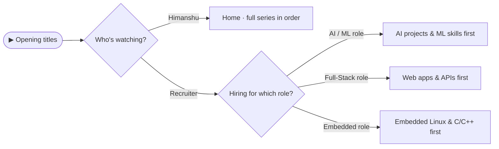

<table>
  <tr>
    <td width="50%">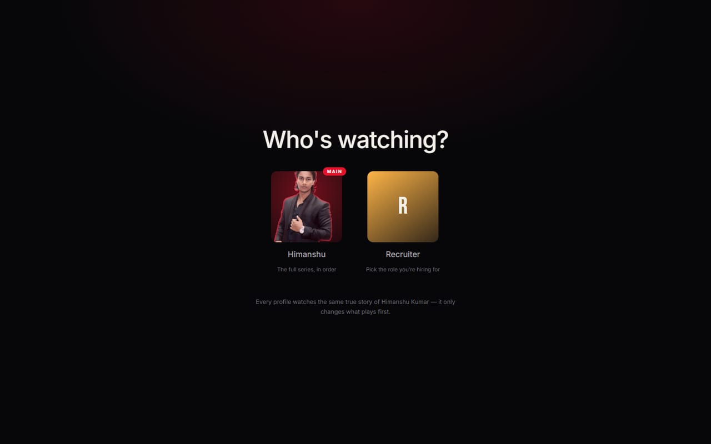</td>
    <td width="50%">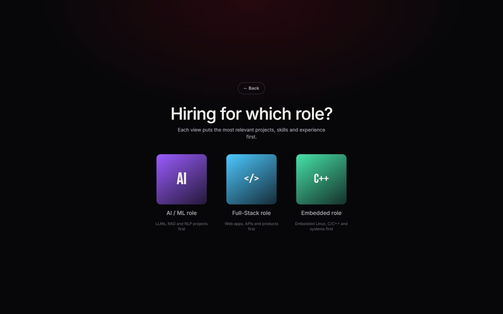</td>
  </tr>
  <tr>
    <td align="center"><b>Who’s watching?</b> — your view or Recruiter</td>
    <td align="center"><b>Hiring for which role?</b> — three recruiter views</td>
  </tr>
</table>

### 🎯 What each recruiter role changes

| | 🤖 AI / ML role | 🌐 Full-Stack role | 🔌 Embedded role |
| --- | --- | --- | --- |
| **Home intro** | LLM, RAG & NLP products | React / TypeScript + Flask / Node products | ABB ZEE600C, kernel & systemd, CFS, Open5GS |
| **First section** | Projects | Projects | Journey |
| **Projects first** | ShadowTrace, MediRAG | AI Fitness Tracker, ShadowTrace | CFS Scheduler, SocketChat |
| **Skills first** | AI / ML | Web & Backend | System (Embedded) |
| **Journey opens on** | Season 3 · Building with AI | Season 3 · Building with AI | Season 4 · Master Class |

Every role also gets a **View Resume** button on the home screen, and recruiters can switch roles anytime from the avatar menu.

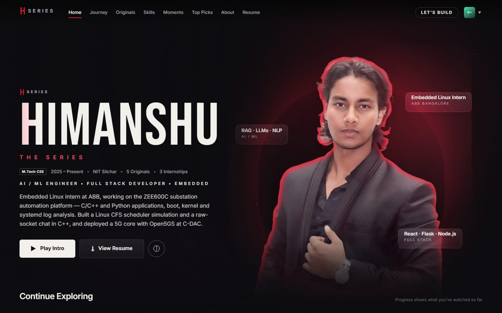

---

## 📸 Inside the series

<table>
  <tr>
    <td width="50%">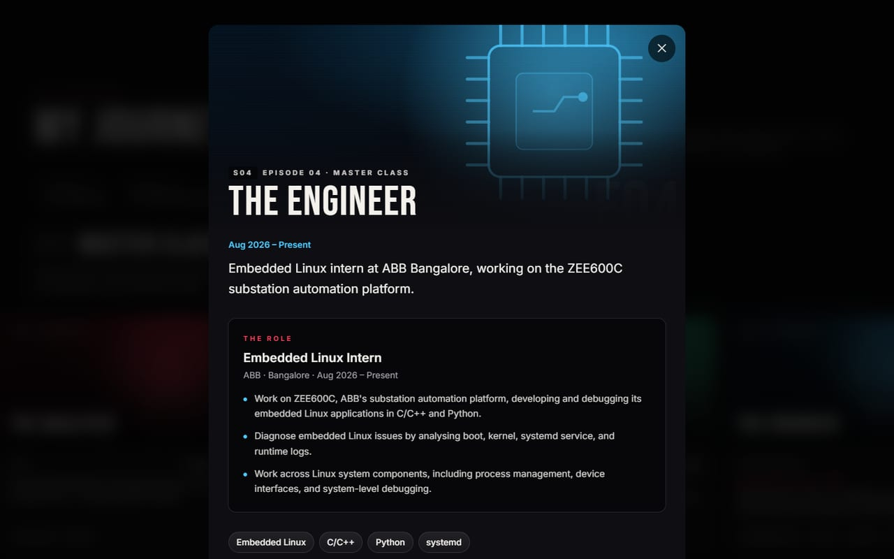</td>
    <td width="50%">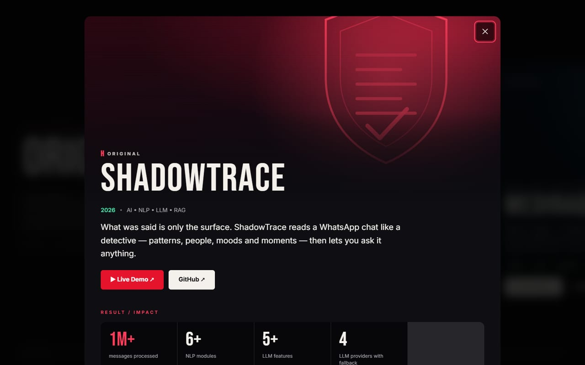</td>
  </tr>
  <tr>
    <td align="center"><b>Journey episode</b> — the full internship, every bullet</td>
    <td align="center"><b>Project Original</b> — impact, stack, demo & code</td>
  </tr>
</table>

<table>
  <tr>
    <td width="68%" valign="top"></td>
    <td width="32%" valign="top">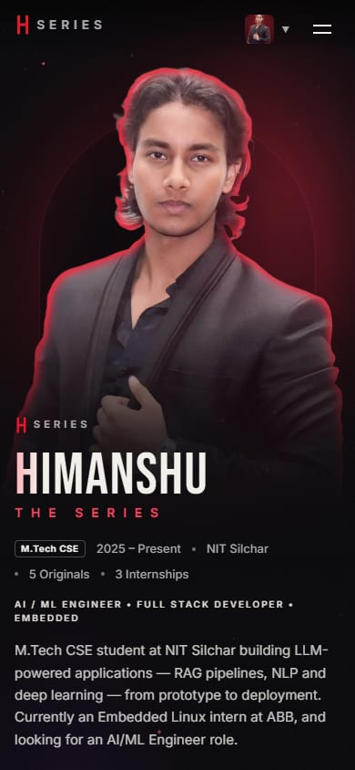</td>
  </tr>
  <tr>
    <td align="center"><b>Desktop</b></td>
    <td align="center"><b>Mobile</b></td>
  </tr>
</table>

---

## 🚀 Quick start

> Requires **Node.js 18+**.

```bash
npm install
npm run dev
```

| URL | What it is |
| --- | --- |
| `http://localhost:5173` | The portfolio |
| `http://localhost:5173/admin` | The admin dashboard |

The dev server also listens on your network, so other devices on the same Wi-Fi can open the address Vite prints under **Network**.

**Production build**

```bash
npm run build      # type-checks, then builds to dist/
npm run preview    # serves the build locally
```

`dist/` is a static site — deploy it as-is to **Vercel**, **Netlify**, **GitHub Pages** or any static host.

---

## 🛠️ Admin dashboard

All content lives in **one file: [`src/data/content.json`](src/data/content.json)**. Change it either way — both edit the same file:

| | How | Best for |
| --- | --- | --- |
| 🖱️ | **Admin dashboard** at `/admin` | Everyday edits, uploads, design tweaks, publishing |
| ⌨️ | **By hand** in `content.json` | Bulk edits, or if you prefer code |

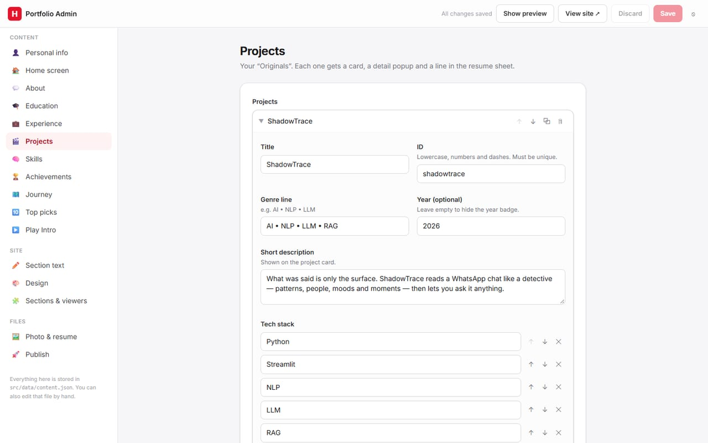

<details>
<summary><b>📋 Every admin page and what it edits</b></summary>
<br />

| Page | What it edits |
| --- | --- |
| 👤 Personal info | Name, intro, role, tagline, email, LinkedIn, GitHub, interests |
| 🏠 Home screen | Badge, info line (with live `{projects}` / `{internships}` counts) and the floating chips |
| 💬 About | The fact tiles next to the photo |
| 🎓 Education · 💼 Experience | Schools, internships and jobs |
| 🎬 Projects | Add, remove, reorder and edit projects — links, stack, bullets, result tiles, colours, background art |
| 🧠 Skills | Skill categories and the “where it shows up” hover notes |
| 🏆 Achievements | Award cards and certifications |
| 🗺️ Journey | Seasons and episodes — link an episode to an internship or a project, add extra details, pick background art |
| 🔟 Top picks · ▶️ Play Intro | The Top 10 row and the highlight-reel slides |
| ✏️ Section text | Every heading, menu name and the footer |
| 🎨 Design | Colour presets, every colour, fonts, opening animation, cursor, film grain |
| 🧩 Sections & viewers | Hide sections; your view; the Recruiter tile; recruiter roles with their own intro and ordering |
| 🖼️ Photo & resume | Upload a new portrait (background removed automatically) or resume PDF |
| 🚀 Publish | Commit and push to GitHub; restore any of the last 30 saves |

</details>

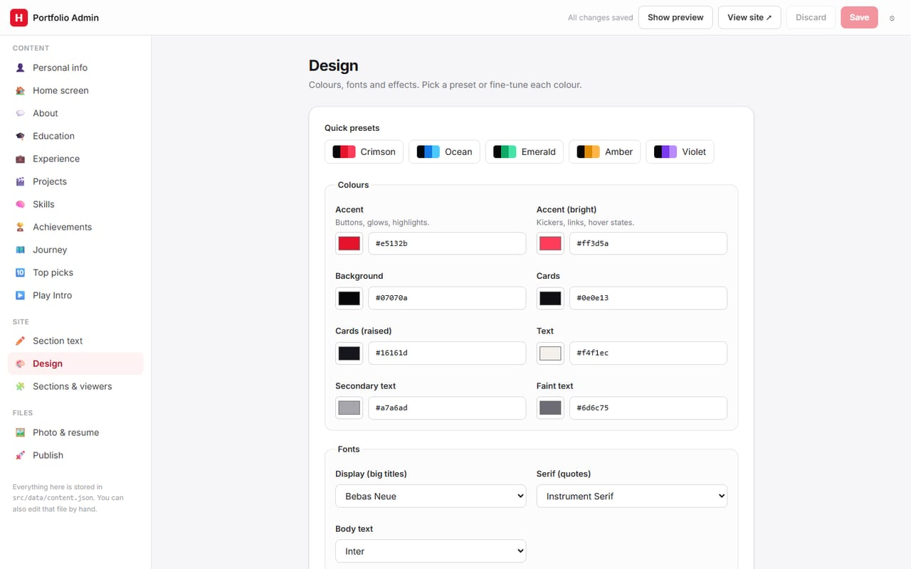

**How saving works**

- 💾 **Save** (or <kbd>Ctrl</kbd> + <kbd>S</kbd>) updates the site instantly and keeps a backup in `.admin-backups/` (last 30, never committed).
- 🛡️ If `content.json` was changed somewhere else since you opened the admin, the save is stopped and you’re offered **Reload latest** — nothing is silently overwritten.
- 🚀 **Publish** commits and pushes to GitHub. Until then, changes exist only on your computer.
- 🔒 The admin runs only with `npm run dev`. It is **not** part of `npm run build`, so a deployed site has no admin.

**Password protection**

Create `.env.local` in the project folder:

```env
ADMIN_PASSWORD=choose-a-strong-password
```

With a password, the admin asks to sign in and works from any device on your network. Without one, it only answers on this computer. `.env.local` is git-ignored, so the password is never published.

<details>
<summary><b>⌨️ Editing <code>content.json</code> by hand</b></summary>
<br />

Each top-level key matches an admin page:

| Key | Holds |
| --- | --- |
| `profile` | Name, intro, contact links, resume file |
| `hero` · `about` | Home-screen badge, info line, chips · About fact tiles |
| `copy` · `sections` | Headings and small text · menu and card names |
| `education` · `experience` | Schools · internships and jobs |
| `projects` | The Originals |
| `skillCategories` · `skillEvidence` | Skills · “where it shows up” notes |
| `achievements` · `certifications` | Award cards · credentials |
| `seasons` · `topPicks` · `introSlides` | Journey · Top 10 · Play Intro |
| `viewers` | Your view, the Recruiter tile and recruiter roles |
| `theme` · `settings` | Colours and fonts · toggles, hidden sections, photo crop |

JSON needs double quotes and no trailing commas. If the site stops loading after a hand edit, the terminal running `npm run dev` points to the line with the mistake.

</details>

<details>
<summary><b>🖼️ Photo and resume without the admin</b></summary>
<br />

- **Resume** — replace `public/assets/Himanshu_Kumar_Resume.pdf` (the download name is `profile.resumeFileName`).
- **Photo** — replace `photo.jpg` (or `photo.png` with a transparent background), then run:

  ```bash
  npm run images
  ```

  This rebuilds the responsive WebP portraits and the social share image in `public/assets/`, using `settings.photoCrop` (`"auto"` finds you in the frame).

</details>

---

## 🧱 Tech stack

| Layer | Tools |
| --- | --- |
| **UI** | React 18 · TypeScript 5.8 |
| **Styling** | Tailwind CSS 4 — theme colours exposed as CSS variables, recoloured live by the admin |
| **Motion** | Framer Motion 11 · Lenis smooth scroll |
| **Build** | Vite 6 |
| **Images** | sharp — automatic background removal, WebP portraits, share image |
| **Admin** | A Vite dev-server plugin (save, uploads, backups, publish) + a React dashboard |

<details>
<summary><b>🗂️ Project structure</b></summary>
<br />

```
src/
├── data/
│   ├── content.json        ← all content, theme and settings (hand-edited or via the admin)
│   ├── portfolio.ts        ← typed access to content.json
│   └── motifs.ts           ← background-art styles
├── focus.tsx               ← the chosen view / recruiter role: what each section shows first
├── theme.ts                ← applies colours and fonts as CSS variables
├── App.tsx                 ← stages: opening → who's watching → home; overlays
├── admin/                  ← admin dashboard UI (served at /admin in dev only)
├── hooks/                  ← smooth scroll + scroll lock, media queries, watch progress
└── components/
    ├── OpeningSequence     ← black → studio card → HIMANSHU → THE SERIES → ▶ PLAY
    ├── ProfileSelector     ← your view or Recruiter → pick a role
    ├── Navbar              ← hide-on-scroll nav, view switcher, mobile menu
    ├── Hero                ← billboard: parallax portrait, particles, floating chips
    ├── PlayIntro           ← ▶ Play Intro highlight reel
    ├── ContinueWatching    ← section cards with real "watched" progress
    ├── About               ← The Pilot
    ├── Seasons · EpisodeCard · EpisodeModal ← the Journey, expandable episodes
    ├── Originals · ProjectCard · ProjectModal ← projects, full-screen overlays
    ├── Poster              ← generated key art (11 background styles)
    ├── TopPicks · Skills · Achievements
    ├── ResumeViewer · ResumeModal ← designed resume sheet, PDF viewer, download
    ├── FinalCTA            ← TO BE CONTINUED… + contact
    └── CustomCursor · fx   ← cursor, magnetic buttons, tilt, reveals, particles
admin/vite-plugin-admin.ts  ← admin API (dev server only)
scripts/portrait.mjs        ← portrait and share-image pipeline
```

</details>

---

## ♿ Accessibility & performance

- 🌀 **Reduced motion respected** — smooth scroll, cursor, tilt, particles, grain and the pinned scroll turn off; the opening jumps to its last frame.
- 👆 **Touch-aware** — hover effects only on precise pointers; touch gets tap interactions and native swipe rails.
- ⌨️ **Keyboard friendly** — every overlay closes with <kbd>Esc</kbd>; reels and episodes move with <kbd>←</kbd> <kbd>→</kbd>.
- ⚡ **Light** — portraits are responsive WebP (about 25–110 KB), overlays are code-split, particles pause off-screen.

## ⌨️ Keyboard shortcuts

| Where | Keys |
| --- | --- |
| Opening | <kbd>Enter</kbd> or <kbd>Esc</kbd> skips |
| Who’s watching? | <kbd>Esc</kbd> picks your view (or goes back from the roles) |
| Play Intro | <kbd>Space</kbd> pause · <kbd>←</kbd> <kbd>→</kbd> slides · <kbd>Esc</kbd> close |
| Journey episode | <kbd>←</kbd> <kbd>→</kbd> previous / next · <kbd>Esc</kbd> close |
| Project & resume overlays | <kbd>Esc</kbd> close |
| Admin | <kbd>Ctrl</kbd> + <kbd>S</kbd> save |

<details>
<summary><b>🩺 Troubleshooting</b></summary>
<br />

- **Admin saves fail after pulling new code** — restart `npm run dev`. The admin’s server part (`admin/vite-plugin-admin.ts`) only reloads on restart.
- **“Content changed elsewhere” in the admin** — `content.json` was edited outside that tab. Click **Reload latest**, then redo your edit.
- **Other devices can’t open the site** — they must be on the same network, and Windows Firewall must allow Node.js on port 5173.
- **Can’t open the admin from another device** — set `ADMIN_PASSWORD` in `.env.local` and restart `npm run dev`.

</details>

---


> A personal portfolio with a fictional streaming-platform look. It is not affiliated with Netflix or any other streaming service and uses none of their logos.

<div align="center">

<br />

**HIMANSHU KUMAR** · *To be continued…*

[LinkedIn](https://www.linkedin.com/in/himanshukumar111/) · [GitHub](https://github.com/himanshugithub360) · [Email](mailto:himanshuramgariya@gmail.com)

</div>
